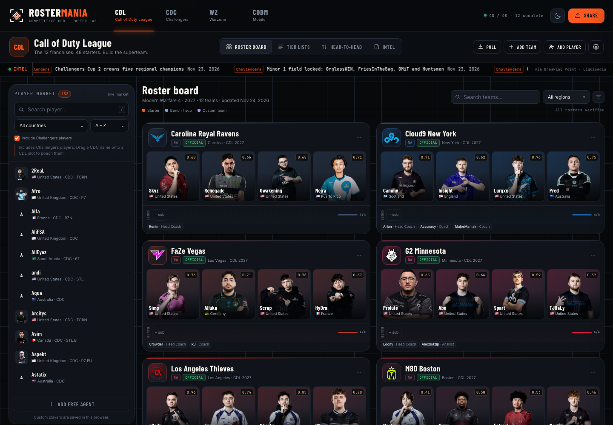
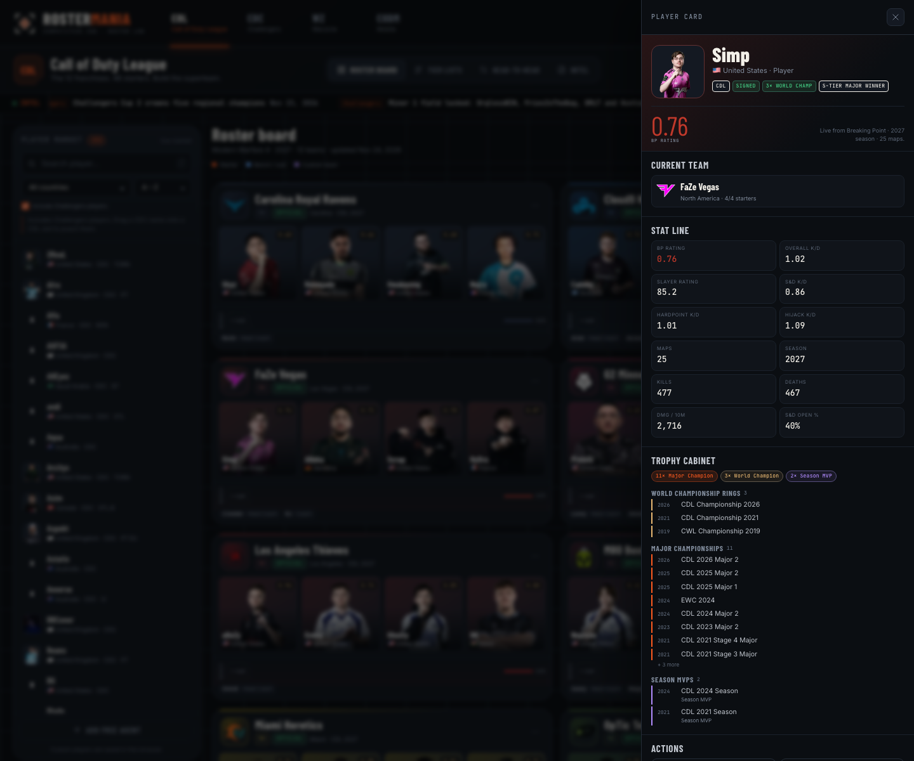

# Call of Duty Esports Hub

**A four-scene Call of Duty roster lab — CDL, Challengers, Warzone and CODM.**

Build rosters, compare players, make tier lists, browse S-tier trophy cabinets and create your own teams. No build step, no framework, no API keys.





---

## Live site

**Live site:** **https://stuart1204.github.io/Call-of-Duty-Esports-Hub/**

You can also run it locally:

```bash
git clone https://github.com/Stuart1204/Call-of-Duty-Esports-Hub.git
cd Call-of-Duty-Esports-Hub
python3 -m http.server 8000
# open http://localhost:8000
```

Everything is local — fonts, logos, player photos and the PNG share-card exporter.

---

## What's inside

| Tab | Teams | Roster slots | Player market | Notes |
|---|---|---|---|---|
| **CDL** | 12 | 48 starters | 0 CDL FAs + 152 CDC market | Official 2027 rosters, staff, real 2027 Breaking Point stats |
| **Challengers** | 28 | 112 | 44 | Cup 2 top teams, Cup 1 winners, Monster Invitational teams and notable orgs |
| **Warzone** | 29 | 3v3 | 152 | The Warzone Rostermania fantasy-draft universe |
| **CODM** | 16 | 5v5 + bench | — | Every team qualified for the 2026 World Championship |

### CDL
- 12 franchises, all 48 starters and coaching staff.
- Real **2027 MW4 Breaking Point** stats on hover and in the player drawer.
- **Update photo / Reset photo** on every player.
- **Player market** only includes players who have competed in MW4 2027:
  - 0 CDL free agents have a 2027 sample.
  - The 152 Challengers players who competed in Cup 1/Cup 2 are available through the **Include Challengers players** toggle.
  - Veterans such as Attach, Enable, Octane and Clayster remain archived in the data but are removed from the market.

### Challengers
- Refreshed to the **Cup 2** top teams from every region:
  - NA: OMiT Brooklyn, FriesInTheBag, Huntsmen, OrglessWIN, Torn Paradox, Telluride Bush, Stallions Black, Telluride Bush B
  - EU: Project 7, Project 7 EU, The Pit, Rauzan Esport, BTD Esports, BBL Bandits
  - AP: Mindfreak.Black, Mindfreak, Unity Visual AP, i2
  - LA: Origin, Unity Visual, Gigiz, Team zNxcho
  - ME: Riyadh Falcons Academy, ZERO, Reapers, 67a6e7 najdd
- Kept the notable orgs: **FC Stallions, OMiT, Telluride Bush, Torn, Huntsmen, Project 7, The Pit, Riyadh Falcons Academy and Gentle Mates Academy**.
- **Minor 1 / Kickoff Classic qualifiers** are all present: OrglessWIN, FriesInTheBag, OMiT Brooklyn and Huntsmen.
- 44 Challengers free agents, including displaced Cup 2 players and the Open bracket pool.
- No stats for Challengers, matching the circuit’s public data.

### Warzone
- The exact 29 orgs and 152-player market from Warzone Rostermania.
- Starts as a fantasy draft: every team is `0/3` and all players are in the market.
- There is no official persisted signed-roster snapshot in the source.

### CODM
- All 16 teams qualified for the **2026 Call of Duty Mobile World Championship**.
- 5 starters plus bench, no free agents.
- Team logos, rosters and S-tier trophy cabinets.

---

## Features

- **Roster board** with team crests, starter slots, bench/sub slots and CDL staff.
- **Player market** with search, country filter, A–Z/rating/country sort, click-to-place and drag-and-drop.
- **Breaking Point stat cards** — BP Rating, K/D, Slayer Rating, S&D K/D, Hardpoint K/D, Hijack K/D, maps, kills, deaths, damage/10M and opening-duel %, for the 2027 MW4 season only.
- **S-tier trophy cabinet** — split into:
  - **World championship rings**
  - **Major championships**
  - **Season MVPs**
- **Tier lists** — S/A/B/C/D for players or teams, auto-seed, drag-to-rank, saved automatically.
- **Head-to-head** — players or teams, with a stat radar for CDL.
- **Custom teams** — name, tag, region, colour, uploaded crest and 3–6 starter slots.
- **Custom players** — add anywhere, with photo upload.
- **Photo updates** — every existing player can have a new photo; images are resized to 500px and stored in the browser.
- **Pull buttons** — a header Pull button and four per-esport Pull buttons in **Intel → Data Sync**. They are intentionally paused while source rate limits clear; no pull is fired until the cooldown is done.
- **Share** — copy roster text, export/import JSON, or download a generated PNG share card.
- **Light/dark theme**, responsive layout, keyboard support and localStorage persistence.

All edits, custom teams, custom players, tier lists, photo overrides and theme are stored locally in the browser. Use the gear icon to export/import or reset.

---

## Data sources

- **CDL 2027 rosters, staff, history and accolades** — [COD Esports Wiki](https://cod-esports.fandom.com/) (CC BY-SA 3.0).
- **Challengers Cup 1/Cup 2 results, rosters and logos** — [Liquipedia Call of Duty](https://liquipedia.net/callofduty) (CC BY-SA).
- **CODM World Championship qualifiers and rosters** — Liquipedia.
- **Player stats** — [Breaking Point](https://breakingpoint.gg/stats), via its public aggregated player-stats endpoint.
- **Accolades** — COD Esports Wiki tournament-result and award tables. Only S-tier events are shown: world championships, S-tier majors and season MVPs. Online-only cash cups and A-tier Challengers events are excluded.
- **Warzone orgs and player market** — [Warzone Rostermania](https://www.warzonerostermania.com/).
- **Intel** — curated from Breaking Point reporting and Liquipedia results.

### Accuracy notes
- Stats are the **2027 MW4 season only** (minimum 5 maps). No 2026/2025 fallback samples are used.
- **Vik** is listed as **zVik** on Breaking Point; his card shows the alias.
- CDL major counts track first-place finishes at S-tier events; online-only GameBattles/cash cups are filtered out.
- The 2027 season is in progress; this is a snapshot from **November 24, 2026**.
- Team names, logos and player likenesses belong to their respective owners. This is a non-commercial fan project, not affiliated with Activision, the CDL, Breaking Point or any team.

---

## Stack

- Static HTML, CSS and vanilla JavaScript.
- Data in `data.js` (canonical) and `data.json` (inspectable copy).
- Self-hosted fonts, local images and `html2canvas` for share cards.
- No server, database or build step.

### File map

```
.
├── index.html              # app shell, tabs, views, modals
├── styles.css              # design system, themes, responsive
├── app.js                  # roster builder, tiers, H2H, trophies, uploads
├── data.js                 # canonical data
├── data.json               # same data, easier to edit
├── fonts-local.css         # self-hosted fonts
├── assets/
│   ├── logos/cdl|challengers|mobile|warzone/
│   ├── players/
│   ├── fonts/
│   ├── favicon.svg
│   └── html2canvas.min.js
├── preview.png
├── preview-trophy.png
├── preview-challengers.png
└── README.md
```

If you edit `data.json`, regenerate `data.js`:

```bash
python3 - <<'PY'
import json
d=json.load(open('data.json'))
with open('data.js','w') as f:
    f.write('window.ROSTERMANIA_DATA = ')
    json.dump(d,f,ensure_ascii=False,separators=(',',':'))
    f.write(';\n')
PY
```

---

## Credits

- Concept: Rostermania.com (CDL) and Warzone Rostermania.
- Data: COD Esports Wiki contributors, Liquipedia contributors, Breaking Point.
- Built for the Call of Duty community.